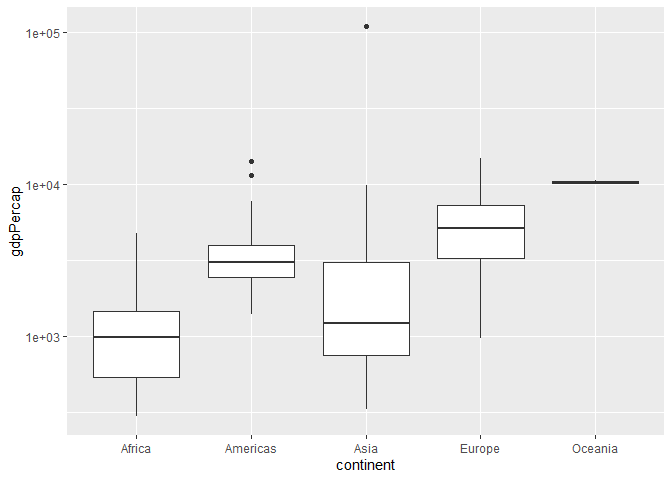
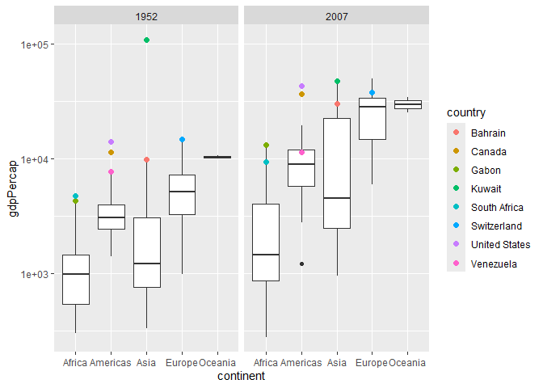
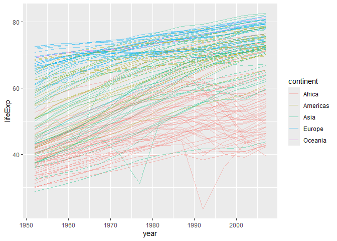
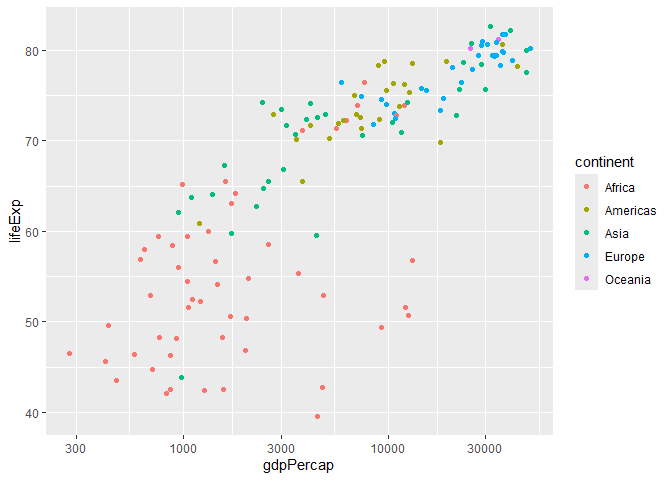
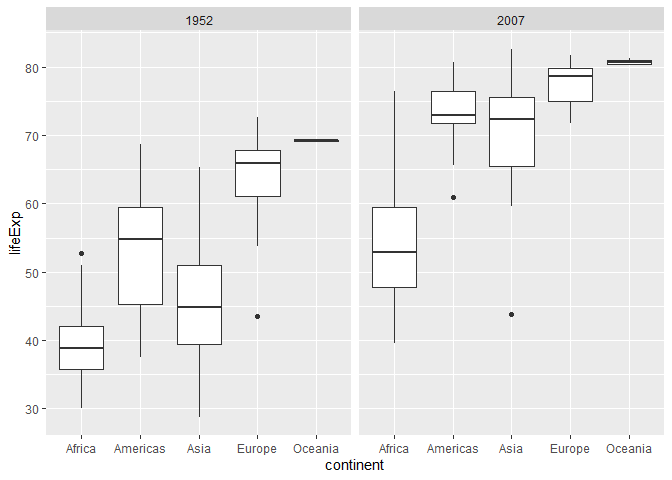

Gapminder
================
Navya Tiwari
2020-

- [Grading Rubric](#grading-rubric)
  - [Individual](#individual)
  - [Submission](#submission)
- [Guided EDA](#guided-eda)
  - [**q0** Perform your “first checks” on the dataset. What variables
    are in
    this](#q0-perform-your-first-checks-on-the-dataset-what-variables-are-in-this)
  - [**q1** Determine the most and least recent years in the `gapminder`
    dataset.](#q1-determine-the-most-and-least-recent-years-in-the-gapminder-dataset)
  - [**q2** Filter on years matching `year_min`, and make a plot of the
    GDP per capita against continent. Choose an appropriate `geom_` to
    visualize the data. What observations can you
    make?](#q2-filter-on-years-matching-year_min-and-make-a-plot-of-the-gdp-per-capita-against-continent-choose-an-appropriate-geom_-to-visualize-the-data-what-observations-can-you-make)
  - [**q3** You should have found *at least* three outliers in q2 (but
    possibly many more!). Identify those outliers (figure out which
    countries they
    are).](#q3-you-should-have-found-at-least-three-outliers-in-q2-but-possibly-many-more-identify-those-outliers-figure-out-which-countries-they-are)
  - [**q4** Create a plot similar to yours from q2 studying both
    `year_min` and `year_max`. Find a way to highlight the outliers from
    q3 on your plot *in a way that lets you identify which country is
    which*. Compare the patterns between `year_min` and
    `year_max`.](#q4-create-a-plot-similar-to-yours-from-q2-studying-both-year_min-and-year_max-find-a-way-to-highlight-the-outliers-from-q3-on-your-plot-in-a-way-that-lets-you-identify-which-country-is-which-compare-the-patterns-between-year_min-and-year_max)
- [Your Own EDA](#your-own-eda)
  - [**q5** Create *at least* three new figures below. With each figure,
    try to pose new questions about the
    data.](#q5-create-at-least-three-new-figures-below-with-each-figure-try-to-pose-new-questions-about-the-data)

*Purpose*: Learning to do EDA well takes practice! In this challenge
you’ll further practice EDA by first completing a guided exploration,
then by conducting your own investigation. This challenge will also give
you a chance to use the wide variety of visual tools we’ve been
learning.

<!-- include-rubric -->

# Grading Rubric

<!-- -------------------------------------------------- -->

Unlike exercises, **challenges will be graded**. The following rubrics
define how you will be graded, both on an individual and team basis.

## Individual

<!-- ------------------------- -->

| Category | Needs Improvement | Satisfactory |
|----|----|----|
| Effort | Some task **q**’s left unattempted | All task **q**’s attempted |
| Observed | Did not document observations, or observations incorrect | Documented correct observations based on analysis |
| Supported | Some observations not clearly supported by analysis | All observations clearly supported by analysis (table, graph, etc.) |
| Assessed | Observations include claims not supported by the data, or reflect a level of certainty not warranted by the data | Observations are appropriately qualified by the quality & relevance of the data and (in)conclusiveness of the support |
| Specified | Uses the phrase “more data are necessary” without clarification | Any statement that “more data are necessary” specifies which *specific* data are needed to answer what *specific* question |
| Code Styled | Violations of the [style guide](https://style.tidyverse.org/) hinder readability | Code sufficiently close to the [style guide](https://style.tidyverse.org/) |

## Submission

<!-- ------------------------- -->

Make sure to commit both the challenge report (`report.md` file) and
supporting files (`report_files/` folder) when you are done! Then submit
a link to Canvas. **Your Challenge submission is not complete without
all files uploaded to GitHub.**

``` r
library(tidyverse)
```

    ## ── Attaching core tidyverse packages ──────────────────────── tidyverse 2.0.0 ──
    ## ✔ dplyr     1.2.1     ✔ readr     2.2.0
    ## ✔ forcats   1.0.1     ✔ stringr   1.6.0
    ## ✔ ggplot2   4.0.3     ✔ tibble    3.3.1
    ## ✔ lubridate 1.9.5     ✔ tidyr     1.3.2
    ## ✔ purrr     1.2.2     
    ## ── Conflicts ────────────────────────────────────────── tidyverse_conflicts() ──
    ## ✖ dplyr::filter() masks stats::filter()
    ## ✖ dplyr::lag()    masks stats::lag()
    ## ℹ Use the conflicted package (<http://conflicted.r-lib.org/>) to force all conflicts to become errors

``` r
library(gapminder)
```

*Background*: [Gapminder](https://www.gapminder.org/about-gapminder/) is
an independent organization that seeks to educate people about the state
of the world. They seek to counteract the worldview constructed by a
hype-driven media cycle, and promote a “fact-based worldview” by
focusing on data. The dataset we’ll study in this challenge is from
Gapminder.

# Guided EDA

<!-- -------------------------------------------------- -->

First, we’ll go through a round of *guided EDA*. Try to pay attention to
the high-level process we’re going through—after this guided round
you’ll be responsible for doing another cycle of EDA on your own!

### **q0** Perform your “first checks” on the dataset. What variables are in this

dataset?

``` r
## TASK: Do your "first checks" here!

gapminder %>%
  glimpse()
```

    ## Rows: 1,704
    ## Columns: 6
    ## $ country   <fct> "Afghanistan", "Afghanistan", "Afghanistan", "Afghanistan", …
    ## $ continent <fct> Asia, Asia, Asia, Asia, Asia, Asia, Asia, Asia, Asia, Asia, …
    ## $ year      <int> 1952, 1957, 1962, 1967, 1972, 1977, 1982, 1987, 1992, 1997, …
    ## $ lifeExp   <dbl> 28.801, 30.332, 31.997, 34.020, 36.088, 38.438, 39.854, 40.8…
    ## $ pop       <int> 8425333, 9240934, 10267083, 11537966, 13079460, 14880372, 12…
    ## $ gdpPercap <dbl> 779.4453, 820.8530, 853.1007, 836.1971, 739.9811, 786.1134, …

**Observations**:

- The variables are `country`, `continent`, `year`, `lifeExp`, `pop`,
  and `gdpPercap`

### **q1** Determine the most and least recent years in the `gapminder` dataset.

*Hint*: Use the `pull()` function to get a vector out of a tibble.
(Rather than the `$` notation of base R.)

``` r
## TASK: Find the largest and smallest values of `year` in `gapminder`

year_max <- gapminder %>%
  pull(year) %>%
  max()

year_min <- gapminder %>%
  pull(year) %>%
  min()

year_max
```

    ## [1] 2007

``` r
year_min
```

    ## [1] 1952

Use the following test to check your work.

``` r
## NOTE: No need to change this
assertthat::assert_that(year_max %% 7 == 5)
```

    ## [1] TRUE

``` r
assertthat::assert_that(year_max %% 3 == 0)
```

    ## [1] TRUE

``` r
assertthat::assert_that(year_min %% 7 == 6)
```

    ## [1] TRUE

``` r
assertthat::assert_that(year_min %% 3 == 2)
```

    ## [1] TRUE

``` r
if (is_tibble(year_max)) {
  print("year_max is a tibble; try using `pull()` to get a vector")
  assertthat::assert_that(False)
}

print("Nice!")
```

    ## [1] "Nice!"

### **q2** Filter on years matching `year_min`, and make a plot of the GDP per capita against continent. Choose an appropriate `geom_` to visualize the data. What observations can you make?

You may encounter difficulties in visualizing these data; if so document
your challenges and attempt to produce the most informative visual you
can.

``` r
## TASK: Create a visual of gdpPercap vs continent

gapminder %>%
  filter(year == year_min) %>%
  ggplot(aes(x = continent, y = gdpPercap)) +
  geom_boxplot() +
  scale_y_continuous(trans = "log10")
```

<!-- -->

**Observations**:

- GDP per capita is pretty different between the continents in 1952.
- Europe and Oceania seem to generally have higher GDP per capita than
  Africa and Asia.
- There are several countries that are way above the rest of their
  continent.
- Asia has a really extreme high value, which turns out to be Kuwait.
- Most of the obvious outliers are on the high end rather than the low
  end.

**Difficulties & Approaches**:

- At first it is hard to see most of the data because a few countries
  have much higher GDP per capita than everyone else.
- On a normal yaxis, those huge values stretch the graph and make the
  other countries look squished together.
- I used a log scale so I could see the smaller values while still
  keeping the large outliers on the graph.

### **q3** You should have found *at least* three outliers in q2 (but possibly many more!). Identify those outliers (figure out which countries they are).

``` r
## TASK: Identify the outliers from q2

gapminder %>%
  filter(year == year_min) %>%
  arrange(desc(gdpPercap)) %>%
  group_by(continent) %>%
  slice(1:3)
```

    ## # A tibble: 14 × 6
    ## # Groups:   continent [5]
    ##    country        continent  year lifeExp       pop gdpPercap
    ##    <fct>          <fct>     <int>   <dbl>     <int>     <dbl>
    ##  1 South Africa   Africa     1952    45.0  14264935     4725.
    ##  2 Gabon          Africa     1952    37.0    420702     4293.
    ##  3 Angola         Africa     1952    30.0   4232095     3521.
    ##  4 United States  Americas   1952    68.4 157553000    13990.
    ##  5 Canada         Americas   1952    68.8  14785584    11367.
    ##  6 Venezuela      Americas   1952    55.1   5439568     7690.
    ##  7 Kuwait         Asia       1952    55.6    160000   108382.
    ##  8 Bahrain        Asia       1952    50.9    120447     9867.
    ##  9 Saudi Arabia   Asia       1952    39.9   4005677     6460.
    ## 10 Switzerland    Europe     1952    69.6   4815000    14734.
    ## 11 Norway         Europe     1952    72.7   3327728    10095.
    ## 12 United Kingdom Europe     1952    69.2  50430000     9980.
    ## 13 New Zealand    Oceania    1952    69.4   1994794    10557.
    ## 14 Australia      Oceania    1952    69.1   8691212    10040.

**Observations**:

- Identify the outlier countries from q2
- The countries that stand out as outliers are South Africa, Gabon,
  United States, Canada, Venezuela, Kuwait, Bahrain, and Switzerland.
  Kuwait is especially extreme compared with the other Asian countries.

*Hint*: For the next task, it’s helpful to know a ggplot trick we’ll
learn in an upcoming exercise: You can use the `data` argument inside
any `geom_*` to modify the data that will be plotted *by that geom
only*. For instance, you can use this trick to filter a set of points to
label:

``` r
## NOTE: No need to edit, use ideas from this in q4 below
gapminder %>%
  filter(year == max(year)) %>%

  ggplot(aes(continent, lifeExp)) +
  geom_boxplot() +
  geom_point(
    data = . %>% filter(country %in% c("United Kingdom", "Japan", "Zambia")),
    mapping = aes(color = country),
    size = 2
  )
```

<!-- -->

### **q4** Create a plot similar to yours from q2 studying both `year_min` and `year_max`. Find a way to highlight the outliers from q3 on your plot *in a way that lets you identify which country is which*. Compare the patterns between `year_min` and `year_max`.

*Hint*: We’ve learned a lot of different ways to show multiple
variables; think about using different aesthetics or facets.

``` r
## TASK: Create a visual of gdpPercap vs continent

gapminder %>%
  filter(year == year_min | year == year_max) %>%
  ggplot(aes(x = continent, y = gdpPercap)) +
  geom_boxplot() +
  scale_y_continuous(trans = "log10") +
  geom_point(
    data = . %>%
      filter(
        country %in% c(
          "South Africa",
          "Gabon",
          "United States",
          "Canada",
          "Venezuela",
          "Kuwait",
          "Bahrain",
          "Switzerland"
        )
      ),
    mapping = aes(color = country),
    size = 2
  ) +
  facet_wrap(~year)
```

<!-- -->

**Observations**:

- Most of the countries that were unusually high in 1952 are still
  toward the higher end of their continents in 2007.
- Kuwait is much less extreme in 2007 than it was in 1952.
- The United States and Canada are still toward the top of the Americas.
- Switzerland is still one of the higher GDP-per-capita countries in
  Europe.
- The distributions generally shift upward from 1952 to 2007, so GDP per
  capita seems to have increased in a lot of countries.
- This graph only compares two years, so I can’t tell from this plot
  alone whether the change happened steadily or whether there were big
  increases and decreases in between.

# Your Own EDA

<!-- -------------------------------------------------- -->

Now it’s your turn! We just went through guided EDA considering the GDP
per capita at two time points. You can continue looking at outliers,
consider different years, repeat the exercise with `lifeExp`, consider
the relationship between variables, or something else entirely.

### **q5** Create *at least* three new figures below. With each figure, try to pose new questions about the data.

Has life expectancy generally increased over time, and do the continents
follow similar patterns?

``` r
gapminder %>%
  ggplot(aes(x = year, y = lifeExp, group = country, color = continent)) +
  geom_line(alpha = 0.4)
```

<!-- -->

- Life expectancy generally seems to increase over time for most
  countries.
- Europe and Oceania tend to have higher life expectancy throughout most
  of the dataset.
- Africa starts lower and still seems lower than the other continents by
  2007.
- Not every country increases smoothly. Some lines have drops at
  different points in time.
- This makes me wonder which countries had the biggest decreases in life
  expectancy and what years those decreases happened.

Do countries with higher GDP per capita also tend to have higher life
expectancy?

``` r
## TASK: Your second graph
gapminder %>%
  filter(year == year_max) %>%
  ggplot(aes(x = gdpPercap, y = lifeExp, color = continent)) +
  geom_point() +
  scale_x_continuous(trans = "log10")
```

<!-- -->

- Countries with higher GDP per capita usually seem to have higher life
  expectancy.
- The relationship doesn’t look completely linear, though.
- At lower GDP values, increases in GDP seem to go along with pretty big
  differences in life expectancy.
- Once GDP per capita gets high, life expectancy seems to level off
  more.
- There are also countries with similar GDP per capita but noticeably
  different life expectancies, so GDP clearly isn’t the only thing
  related to life expectancy.

Did all continents improve by roughly the same amount?

``` r
## TASK: Your third graph
gapminder %>%
  filter(year == year_min | year == year_max) %>%
  ggplot(aes(x = continent, y = lifeExp)) +
  geom_boxplot() +
  facet_wrap(~year)
```

<!-- -->

- Every continent’s life expectancy distribution seems higher in 2007
  than in 1952.
- Europe and Oceania already had relatively high life expectancy in
  1952, so their change doesn’t look as dramatic.
- Asia seems to have a pretty noticeable upward shift.
- Africa improves too, but its 2007 distribution is still lower than the
  other continents.
- There is still a lot of variation inside continents, so continent
  alone doesn’t explain all the differences between countries.
- I’d be curious whether the gap between the highest- and
  lowest-life-expectancy countries got smaller or larger over this
  period.
