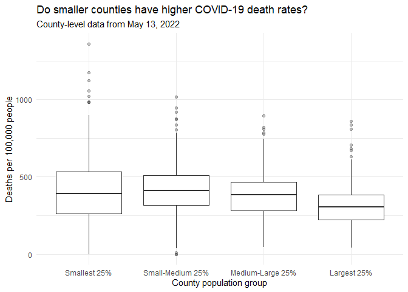

COVID-19
================
Navya Tiwari
2020-

- [Grading Rubric](#grading-rubric)
  - [Individual](#individual)
  - [Submission](#submission)
- [The Big Picture](#the-big-picture)
- [Get the Data](#get-the-data)
  - [Navigating the Census Bureau](#navigating-the-census-bureau)
    - [**q1** Load Table `B01003` into the following tibble. Make sure
      the column names are
      `id, Geographic Area Name, Estimate!!Total, Margin of Error!!Total`.](#q1-load-table-b01003-into-the-following-tibble-make-sure-the-column-names-are-id-geographic-area-name-estimatetotal-margin-of-errortotal)
  - [Automated Download of NYT Data](#automated-download-of-nyt-data)
    - [**q2** Visit the NYT GitHub repo and find the URL for the **raw**
      US County-level data. Assign that URL as a string to the variable
      below.](#q2-visit-the-nyt-github-repo-and-find-the-url-for-the-raw-us-county-level-data-assign-that-url-as-a-string-to-the-variable-below)
- [Join the Data](#join-the-data)
  - [**q3** Process the `id` column of `df_pop` to create a `fips`
    column.](#q3-process-the-id-column-of-df_pop-to-create-a-fips-column)
  - [**q4** Join `df_covid` with `df_q3` by the `fips` column. Use the
    proper type of join to preserve *only* the rows in
    `df_covid`.](#q4-join-df_covid-with-df_q3-by-the-fips-column-use-the-proper-type-of-join-to-preserve-only-the-rows-in-df_covid)
- [Analyze](#analyze)
  - [Normalize](#normalize)
    - [**q5** Use the `population` estimates in `df_data` to normalize
      `cases` and `deaths` to produce per 100,000 counts \[3\]. Store
      these values in the columns `cases_per100k` and
      `deaths_per100k`.](#q5-use-the-population-estimates-in-df_data-to-normalize-cases-and-deaths-to-produce-per-100000-counts-3-store-these-values-in-the-columns-cases_per100k-and-deaths_per100k)
  - [Guided EDA](#guided-eda)
    - [**q6** Compute some summaries](#q6-compute-some-summaries)
  - [Self-directed EDA](#self-directed-eda)
    - [**q8** Drive your own ship: You’ve just put together a very rich
      dataset; you now get to explore! Pick your own direction and
      generate at least one punchline figure to document an interesting
      finding. I give a couple tips & ideas
      below:](#q8-drive-your-own-ship-youve-just-put-together-a-very-rich-dataset-you-now-get-to-explore-pick-your-own-direction-and-generate-at-least-one-punchline-figure-to-document-an-interesting-finding-i-give-a-couple-tips--ideas-below)
    - [Ideas](#ideas)
    - [My Analysis](#my-analysis)
    - [My observationd](#my-observationd)
- [Notes](#notes)

*Purpose*: In this challenge, you’ll learn how to navigate the U.S.
Census Bureau website, programmatically download data from the internet,
and perform a county-level population-weighted analysis of current
COVID-19 trends. This will give you the base for a very deep
investigation of COVID-19, which we’ll build upon for Project 1.

<!-- include-rubric -->

# Grading Rubric

<!-- -------------------------------------------------- -->

Unlike exercises, **challenges will be graded**. The following rubrics
define how you will be graded, both on an individual and team basis.

## Individual

<!-- ------------------------- -->

| Category | Needs Improvement | Satisfactory |
|----|----|----|
| Effort | Some task **q**’s left unattempted | All task **q**’s attempted |
| Observed | Did not document observations, or observations incorrect | Documented correct observations based on analysis |
| Supported | Some observations not clearly supported by analysis | All observations clearly supported by analysis (table, graph, etc.) |
| Assessed | Observations include claims not supported by the data, or reflect a level of certainty not warranted by the data | Observations are appropriately qualified by the quality & relevance of the data and (in)conclusiveness of the support |
| Specified | Uses the phrase “more data are necessary” without clarification | Any statement that “more data are necessary” specifies which *specific* data are needed to answer what *specific* question |
| Code Styled | Violations of the [style guide](https://style.tidyverse.org/) hinder readability | Code sufficiently close to the [style guide](https://style.tidyverse.org/) |

## Submission

<!-- ------------------------- -->

Make sure to commit both the challenge report (`report.md` file) and
supporting files (`report_files/` folder) when you are done! Then submit
a link to Canvas. **Your Challenge submission is not complete without
all files uploaded to GitHub.**

``` r
library(tidyverse)
```

    ## ── Attaching core tidyverse packages ──────────────────────── tidyverse 2.0.0 ──
    ## ✔ dplyr     1.2.1     ✔ readr     2.2.0
    ## ✔ forcats   1.0.1     ✔ stringr   1.6.0
    ## ✔ ggplot2   4.0.3     ✔ tibble    3.3.1
    ## ✔ lubridate 1.9.5     ✔ tidyr     1.3.2
    ## ✔ purrr     1.2.2     
    ## ── Conflicts ────────────────────────────────────────── tidyverse_conflicts() ──
    ## ✖ dplyr::filter() masks stats::filter()
    ## ✖ dplyr::lag()    masks stats::lag()
    ## ℹ Use the conflicted package (<http://conflicted.r-lib.org/>) to force all conflicts to become errors

*Background*:
[COVID-19](https://en.wikipedia.org/wiki/Coronavirus_disease_2019) is
the disease caused by the virus SARS-CoV-2. In 2020 it became a global
pandemic, leading to huge loss of life and tremendous disruption to
society. The New York Times (as of writing) publishes up-to-date data on
the progression of the pandemic across the United States—we will study
these data in this challenge.

*Optional Readings*: I’ve found this [ProPublica
piece](https://www.propublica.org/article/how-to-understand-covid-19-numbers)
on “How to understand COVID-19 numbers” to be very informative!

# The Big Picture

<!-- -------------------------------------------------- -->

We’re about to go through *a lot* of weird steps, so let’s first fix the
big picture firmly in mind:

We want to study COVID-19 in terms of data: both case counts (number of
infections) and deaths. We’re going to do a county-level analysis in
order to get a high-resolution view of the pandemic. Since US counties
can vary widely in terms of their population, we’ll need population
estimates in order to compute infection rates (think back to the
`Titanic` challenge).

That’s the high-level view; now let’s dig into the details.

# Get the Data

<!-- -------------------------------------------------- -->

1.  County-level population estimates (Census Bureau)
2.  County-level COVID-19 counts (New York Times)

## Navigating the Census Bureau

<!-- ------------------------- -->

**Steps**: Our objective is to find the 2018 American Community
Survey\[1\] (ACS) Total Population estimates, disaggregated by counties.
To check your results, this is Table `B01003`.

1.  Go to [data.census.gov](data.census.gov).
2.  Scroll down and click `View Tables`.
3.  Apply filters to find the ACS **Total Population** estimates,
    disaggregated by counties. I used the filters:

- `Topics > Populations and People > Counts, Estimates, and Projections > Population Total`
- `Geography > County > All counties in United States`

5.  Select the **Total Population** table and click the `Download`
    button to download the data; make sure to select the 2018 5-year
    estimates.
6.  Unzip and move the data to your `challenges/data` folder.

- Note that the data will have a crazy-long filename like
  `ACSDT5Y2018.B01003_data_with_overlays_2020-07-26T094857.csv`. That’s
  because metadata is stored in the filename, such as the year of the
  estimate (`Y2018`) and my access date (`2020-07-26`). **Your filename
  will vary based on when you download the data**, so make sure to copy
  the filename that corresponds to what you downloaded!

### **q1** Load Table `B01003` into the following tibble. Make sure the column names are `id, Geographic Area Name, Estimate!!Total, Margin of Error!!Total`.

*Hint*: You will need to use the `skip` keyword when loading these data!

``` r
## TASK: Load the census bureau data with the following tibble name.

df_pop <- read_csv(
  "./data/ACSDT5Y2018.B01003-County-Data.csv",
  skip = 2,
  col_names = c(
    "id",
    "Geographic Area Name",
    "Estimate!!Total",
    "Margin of Error!!Total"
  ),
  show_col_types = FALSE
)

glimpse(df_pop)
```

    ## Rows: 3,220
    ## Columns: 4
    ## $ id                       <chr> "0500000US01001", "0500000US01003", "0500000U…
    ## $ `Geographic Area Name`   <chr> "Autauga County, Alabama", "Baldwin County, A…
    ## $ `Estimate!!Total`        <dbl> 55200, 208107, 25782, 22527, 57645, 10352, 20…
    ## $ `Margin of Error!!Total` <chr> "*****", "*****", "*****", "*****", "*****", …

*Note*: You can find information on 1-year, 3-year, and 5-year estimates
[here](https://www.census.gov/programs-surveys/acs/guidance/estimates.html).
The punchline is that 5-year estimates are more reliable but less
current.

## Automated Download of NYT Data

<!-- ------------------------- -->

ACS 5-year estimates don’t change all that often, but the COVID-19 data
are changing rapidly. To that end, it would be nice to be able to
*programmatically* download the most recent data for analysis; that way
we can update our analysis whenever we want simply by re-running our
notebook. This next problem will have you set up such a pipeline.

The New York Times is publishing up-to-date data on COVID-19 on
[GitHub](https://github.com/nytimes/covid-19-data).

### **q2** Visit the NYT [GitHub](https://github.com/nytimes/covid-19-data) repo and find the URL for the **raw** US County-level data. Assign that URL as a string to the variable below.

``` r
## TASK: Find the URL for the NYT covid-19 county-level data
url_counties <- "https://raw.githubusercontent.com/nytimes/covid-19-data/master/us-counties.csv"
```

Once you have the url, the following code will download a local copy of
the data, then load the data into R.

``` r
## NOTE: No need to change this; just execute
## Set the filename of the data to download
filename_nyt <- "./data/nyt_counties.csv"

## Download the data locally
curl::curl_download(
        url_counties,
        destfile = filename_nyt
      )

## Loads the downloaded csv
df_covid <- read_csv(filename_nyt)
```

    ## Rows: 2502832 Columns: 6
    ## ── Column specification ────────────────────────────────────────────────────────
    ## Delimiter: ","
    ## chr  (3): county, state, fips
    ## dbl  (2): cases, deaths
    ## date (1): date
    ## 
    ## ℹ Use `spec()` to retrieve the full column specification for this data.
    ## ℹ Specify the column types or set `show_col_types = FALSE` to quiet this message.

You can now re-run the chunk above (or the entire notebook) to pull the
most recent version of the data. Thus you can periodically re-run this
notebook to check in on the pandemic as it evolves.

*Note*: You should feel free to copy-paste the code above for your own
future projects!

# Join the Data

<!-- -------------------------------------------------- -->

To get a sense of our task, let’s take a glimpse at our two data
sources.

``` r
## NOTE: No need to change this; just execute
df_pop %>% glimpse
```

    ## Rows: 3,220
    ## Columns: 4
    ## $ id                       <chr> "0500000US01001", "0500000US01003", "0500000U…
    ## $ `Geographic Area Name`   <chr> "Autauga County, Alabama", "Baldwin County, A…
    ## $ `Estimate!!Total`        <dbl> 55200, 208107, 25782, 22527, 57645, 10352, 20…
    ## $ `Margin of Error!!Total` <chr> "*****", "*****", "*****", "*****", "*****", …

``` r
df_covid %>% glimpse
```

    ## Rows: 2,502,832
    ## Columns: 6
    ## $ date   <date> 2020-01-21, 2020-01-22, 2020-01-23, 2020-01-24, 2020-01-24, 20…
    ## $ county <chr> "Snohomish", "Snohomish", "Snohomish", "Cook", "Snohomish", "Or…
    ## $ state  <chr> "Washington", "Washington", "Washington", "Illinois", "Washingt…
    ## $ fips   <chr> "53061", "53061", "53061", "17031", "53061", "06059", "17031", …
    ## $ cases  <dbl> 1, 1, 1, 1, 1, 1, 1, 1, 1, 1, 1, 1, 1, 1, 1, 1, 1, 1, 1, 1, 1, …
    ## $ deaths <dbl> 0, 0, 0, 0, 0, 0, 0, 0, 0, 0, 0, 0, 0, 0, 0, 0, 0, 0, 0, 0, 0, …

To join these datasets, we’ll need to use [FIPS county
codes](https://en.wikipedia.org/wiki/FIPS_county_code).\[2\] The last
`5` digits of the `id` column in `df_pop` is the FIPS county code, while
the NYT data `df_covid` already contains the `fips`.

### **q3** Process the `id` column of `df_pop` to create a `fips` column.

``` r
## TASK: Create a `fips` column by extracting the county code
df_q3 <- df_pop %>%
  mutate(fips = str_sub(id, -5))

glimpse(df_q3)
```

    ## Rows: 3,220
    ## Columns: 5
    ## $ id                       <chr> "0500000US01001", "0500000US01003", "0500000U…
    ## $ `Geographic Area Name`   <chr> "Autauga County, Alabama", "Baldwin County, A…
    ## $ `Estimate!!Total`        <dbl> 55200, 208107, 25782, 22527, 57645, 10352, 20…
    ## $ `Margin of Error!!Total` <chr> "*****", "*****", "*****", "*****", "*****", …
    ## $ fips                     <chr> "01001", "01003", "01005", "01007", "01009", …

Use the following test to check your answer.

``` r
## NOTE: No need to change this
## Check known county
assertthat::assert_that(
              (df_q3 %>%
              filter(str_detect(`Geographic Area Name`, "Autauga County")) %>%
              pull(fips)) == "01001"
            )
```

    ## [1] TRUE

``` r
print("Very good!")
```

    ## [1] "Very good!"

### **q4** Join `df_covid` with `df_q3` by the `fips` column. Use the proper type of join to preserve *only* the rows in `df_covid`.

``` r
## TASK: Join df_covid and df_q3 by fips.
df_q4 <- df_covid %>%
  left_join(df_q3, by = "fips")

glimpse(df_q4)
```

    ## Rows: 2,502,832
    ## Columns: 10
    ## $ date                     <date> 2020-01-21, 2020-01-22, 2020-01-23, 2020-01-…
    ## $ county                   <chr> "Snohomish", "Snohomish", "Snohomish", "Cook"…
    ## $ state                    <chr> "Washington", "Washington", "Washington", "Il…
    ## $ fips                     <chr> "53061", "53061", "53061", "17031", "53061", …
    ## $ cases                    <dbl> 1, 1, 1, 1, 1, 1, 1, 1, 1, 1, 1, 1, 1, 1, 1, …
    ## $ deaths                   <dbl> 0, 0, 0, 0, 0, 0, 0, 0, 0, 0, 0, 0, 0, 0, 0, …
    ## $ id                       <chr> "0500000US53061", "0500000US53061", "0500000U…
    ## $ `Geographic Area Name`   <chr> "Snohomish County, Washington", "Snohomish Co…
    ## $ `Estimate!!Total`        <dbl> 786620, 786620, 786620, 5223719, 786620, 3164…
    ## $ `Margin of Error!!Total` <chr> "*****", "*****", "*****", "*****", "*****", …

Use the following test to check your answer.

``` r
## NOTE: No need to change this
if (!any(df_q4 %>% pull(fips) %>% str_detect(., "02105"), na.rm = TRUE)) {
  assertthat::assert_that(TRUE)
} else {
  print(str_c(
    "Your df_q4 contains a row for the Hoonah-Angoon Census Area (AK),",
    "which is not in df_covid. You used the incorrect join type.",
    sep = " "
  ))
  assertthat::assert_that(FALSE)
}
```

    ## [1] TRUE

``` r
if (any(df_q4 %>% pull(fips) %>% str_detect(., "78010"), na.rm = TRUE)) {
  assertthat::assert_that(TRUE)
} else {
  print(str_c(
    "Your df_q4 does not include St. Croix, US Virgin Islands,",
    "which is in df_covid. You used the incorrect join type.",
    sep = " "
  ))
  assertthat::assert_that(FALSE)
}
```

    ## [1] TRUE

``` r
print("Very good!")
```

    ## [1] "Very good!"

For convenience, I down-select some columns and produce more convenient
column names.

``` r
## NOTE: No need to change; run this to produce a more convenient tibble
df_data <-
  df_q4 %>%
  select(
    date,
    county,
    state,
    fips,
    cases,
    deaths,
    population = `Estimate!!Total`
  )
```

# Analyze

<!-- -------------------------------------------------- -->

Now that we’ve done the hard work of loading and wrangling the data, we
can finally start our analysis. Our first step will be to produce county
population-normalized cases and death counts. Then we will explore the
data.

## Normalize

<!-- ------------------------- -->

### **q5** Use the `population` estimates in `df_data` to normalize `cases` and `deaths` to produce per 100,000 counts \[3\]. Store these values in the columns `cases_per100k` and `deaths_per100k`.

``` r
## TASK: Normalize cases and deaths
df_normalized <- df_data %>%
  mutate(
    cases_per100k = cases / population * 100000,
    deaths_per100k = deaths / population * 100000
  )

glimpse(df_normalized)
```

    ## Rows: 2,502,832
    ## Columns: 9
    ## $ date           <date> 2020-01-21, 2020-01-22, 2020-01-23, 2020-01-24, 2020-0…
    ## $ county         <chr> "Snohomish", "Snohomish", "Snohomish", "Cook", "Snohomi…
    ## $ state          <chr> "Washington", "Washington", "Washington", "Illinois", "…
    ## $ fips           <chr> "53061", "53061", "53061", "17031", "53061", "06059", "…
    ## $ cases          <dbl> 1, 1, 1, 1, 1, 1, 1, 1, 1, 1, 1, 1, 1, 1, 1, 1, 1, 1, 1…
    ## $ deaths         <dbl> 0, 0, 0, 0, 0, 0, 0, 0, 0, 0, 0, 0, 0, 0, 0, 0, 0, 0, 0…
    ## $ population     <dbl> 786620, 786620, 786620, 5223719, 786620, 3164182, 52237…
    ## $ cases_per100k  <dbl> 0.12712619, 0.12712619, 0.12712619, 0.01914345, 0.12712…
    ## $ deaths_per100k <dbl> 0, 0, 0, 0, 0, 0, 0, 0, 0, 0, 0, 0, 0, 0, 0, 0, 0, 0, 0…

You may use the following test to check your work.

``` r
## NOTE: No need to change this
## Check known county data
if (any(df_normalized %>% pull(date) %>% str_detect(., "2020-01-21"))) {
  assertthat::assert_that(TRUE)
} else {
  print(str_c(
    "Date 2020-01-21 not found; did you download the historical data (correct),",
    "or just the most recent data (incorrect)?",
    sep = " "
  ))
  assertthat::assert_that(FALSE)
}
```

    ## [1] TRUE

``` r
if (any(df_normalized %>% pull(date) %>% str_detect(., "2022-05-13"))) {
  assertthat::assert_that(TRUE)
} else {
  print(str_c(
    "Date 2022-05-13 not found; did you download the historical data (correct),",
    "or a single year's data (incorrect)?",
    sep = " "
  ))
  assertthat::assert_that(FALSE)
}
```

    ## [1] TRUE

``` r
## Check datatypes
assertthat::assert_that(is.numeric(df_normalized$cases))
```

    ## [1] TRUE

``` r
assertthat::assert_that(is.numeric(df_normalized$deaths))
```

    ## [1] TRUE

``` r
assertthat::assert_that(is.numeric(df_normalized$population))
```

    ## [1] TRUE

``` r
assertthat::assert_that(is.numeric(df_normalized$cases_per100k))
```

    ## [1] TRUE

``` r
assertthat::assert_that(is.numeric(df_normalized$deaths_per100k))
```

    ## [1] TRUE

``` r
## Check that normalization is correct
assertthat::assert_that(
              abs(df_normalized %>%
               filter(
                 str_detect(county, "Snohomish"),
                 date == "2020-01-21"
               ) %>%
              pull(cases_per100k) - 0.127) < 1e-3
            )
```

    ## [1] TRUE

``` r
assertthat::assert_that(
              abs(df_normalized %>%
               filter(
                 str_detect(county, "Snohomish"),
                 date == "2020-01-21"
               ) %>%
              pull(deaths_per100k) - 0) < 1e-3
            )
```

    ## [1] TRUE

``` r
print("Excellent!")
```

    ## [1] "Excellent!"

## Guided EDA

<!-- ------------------------- -->

Before turning you loose, let’s complete a couple guided EDA tasks.

### **q6** Compute some summaries

Compute the mean and standard deviation for `cases_per100k` and
`deaths_per100k`. *Make sure to carefully choose **which rows** to
include in your summaries,* and justify why!

``` r
## TASK: Compute mean and sd for cases_per100k and deaths_per100k

df_q6 <- df_normalized %>%
  filter(
    date == max(date),
    !is.na(cases_per100k),
    !is.na(deaths_per100k)
  )

df_q6 %>%
  summarize(
    mean_cases = mean(cases_per100k),
    sd_cases = sd(cases_per100k),
    mean_deaths = mean(deaths_per100k),
    sd_deaths = sd(deaths_per100k)
  )
```

    ## # A tibble: 1 × 4
    ##   mean_cases sd_cases mean_deaths sd_deaths
    ##        <dbl>    <dbl>       <dbl>     <dbl>
    ## 1     24967.    6174.        375.      160.

- Which rows did you pick?
  - I started by looking at the dates in our dataset. Since we have
    COVID-19 data for each county across multiple dates, I decided to
    focus on just the most recent date. I then removed any rows where
    the cases or deaths per a hundred thousand people were missing.
- Why?
  - I chose the most reecent date because the COVID-19 cases and deaths
    are cumulative, meaning that each new date includes the counts form
    previous dates. If we used every date, we would end up including the
    same counties over and over again. By picking the latest date, we
    can compare all the counties at the same point in time.

    I also removed the missing values because we wouldn’t be able to
    calculate meaningful averages for those rows. Once we had the
    remaining counties, I calculated the mean to see the average number
    of cases and deaths per 100,000 people, and the standard deviation
    to see how much these numbers varied across counties.

**q7 Find and compare the top 10**

Find the top 10 counties in terms of `cases_per100k`, and the top 10 in
terms of `deaths_per100k`. Report the population of each county along
with the per-100,000 counts. Compare the counts against the mean values
you found in q6. Note any observations.

``` r
mean_cases <- mean(df_q6$cases_per100k)
mean_deaths <- mean(df_q6$deaths_per100k)

df_top_cases <- df_q6 %>%
  arrange(desc(cases_per100k)) %>%
  slice_head(n = 10) %>%
  mutate(
    times_mean = cases_per100k / mean_cases
  ) %>%
  select(
    date, county, state, population,
    cases_per100k, times_mean
  )

df_top_cases
```

    ## # A tibble: 10 × 6
    ##    date       county                   state population cases_per100k times_mean
    ##    <date>     <chr>                    <chr>      <dbl>         <dbl>      <dbl>
    ##  1 2022-05-13 Loving                   Texas        102       192157.       7.70
    ##  2 2022-05-13 Chattahoochee            Geor…      10767        69527.       2.78
    ##  3 2022-05-13 Nome Census Area         Alas…       9925        62922.       2.52
    ##  4 2022-05-13 Northwest Arctic Borough Alas…       7734        62542.       2.51
    ##  5 2022-05-13 Crowley                  Colo…       5630        59449.       2.38
    ##  6 2022-05-13 Bethel Census Area       Alas…      18040        57439.       2.30
    ##  7 2022-05-13 Dewey                    Sout…       5779        54317.       2.18
    ##  8 2022-05-13 Dimmit                   Texas      10663        54019.       2.16
    ##  9 2022-05-13 Jim Hogg                 Texas       5282        50133.       2.01
    ## 10 2022-05-13 Kusilvak Census Area     Alas…       8198        49817.       2.00

``` r
df_top_deaths <- df_q6 %>%
  arrange(desc(deaths_per100k)) %>%
  slice_head(n = 10) %>%
  mutate(
    times_mean = deaths_per100k / mean_deaths
  ) %>%
  select(
    date, county, state, population,
    deaths_per100k, times_mean
  )

df_top_deaths
```

    ## # A tibble: 10 × 6
    ##    date       county            state       population deaths_per100k times_mean
    ##    <date>     <chr>             <chr>            <dbl>          <dbl>      <dbl>
    ##  1 2022-05-13 McMullen          Texas              662          1360.       3.62
    ##  2 2022-05-13 Galax city        Virginia          6638          1175.       3.13
    ##  3 2022-05-13 Motley            Texas             1156          1125.       3.00
    ##  4 2022-05-13 Hancock           Georgia           8535          1054.       2.81
    ##  5 2022-05-13 Emporia city      Virginia          5381          1022.       2.72
    ##  6 2022-05-13 Towns             Georgia          11417          1016.       2.71
    ##  7 2022-05-13 Jerauld           South Dako…       2029           986.       2.63
    ##  8 2022-05-13 Loving            Texas              102           980.       2.61
    ##  9 2022-05-13 Robertson         Kentucky          2143           980.       2.61
    ## 10 2022-05-13 Martinsville city Virginia         13101           946.       2.52

``` r
mean_cases
```

    ## [1] 24966.74

``` r
mean_deaths
```

    ## [1] 375.1242

``` r
unique(df_q6$date)
```

    ## [1] "2022-05-13"

**Observations**:

- I started by looking at the top 10 counties for cases and deaths per
  100,000 people. One thing I noticed was that a lot of these counties
  had pretty small populations. For example, Loving County in Texas only
  has 102 people, but it appears in both lists. This made me think about
  how population size affects these rates, since even a small increase
  in cases or deaths can make a big difference in counties with fewer
  people.

- When I compared the case rates to the mean from Q6, which was around
  24,967 cases per 100,000 people, Loving County stood out the most. It
  had around 192,157 cases per 100,000, which is about 7.7 times the
  average! The next highest was Chattahoochee County in Georgia, with
  around 69,527 cases per 100,000, or 2.8 times the average. I thought
  the difference between the first and second counties was especially
  interesting.

- For deaths, the average was around 375 per 100,000 people. McMullen
  County in Texas had the highest death rate at around 1,360, which is
  about 3.6 times the average. Even the county ranked tenth had a death
  rate more than twice the average.

- I also noticed that Alaska appeared four times in the top 10 counties
  for cases, while Texas and Virginia appeared multiple times in the
  deaths list. Interestingly, Loving County was the only county that
  appeared in both top 10 lists. This suggests that counties with the
  highest reported case rates don’t necessarily have the highest death
  rates.

- When did these “largest values” occur?

  - All the values I compared were from May 13, 2022, since I filtered
    the data to the most recent date available in our dataset. So these
    are the highest cumulative rates on that date, rather than
    necessarily the highest values across the entire dataset.

## Self-directed EDA

<!-- ------------------------- -->

### **q8** Drive your own ship: You’ve just put together a very rich dataset; you now get to explore! Pick your own direction and generate at least one punchline figure to document an interesting finding. I give a couple tips & ideas below:

### Ideas

<!-- ------------------------- -->

- Look for outliers.
- Try web searching for news stories in some of the outlier counties.
- Investigate relationships between county population and counts.
- Do a deep-dive on counties that are important to you (e.g. where you
  or your family live).
- Fix the *geographic exceptions* noted below to study New York City.
- Your own idea!

**DO YOUR OWN ANALYSIS HERE**

### My Analysis

For Q8, I think we should explore something we noticed in Q7: Why do so
many counties with high COVID-19 death rates have small populations?

Our research question can be:

How does county population size relate to COVID-19 death rates per
100,000 people?

We’ll divide counties into four groups based on population size and
create a boxplot to compare their death rates.

``` r
df_q8 <- df_q6 %>%
  filter(population > 0) %>%
  mutate(
    population_group = ntile(population, 4),
    population_group = factor(
      population_group,
      levels = 1:4,
      labels = c(
        "Smallest 25%",
        "Small-Medium 25%",
        "Medium-Large 25%",
        "Largest 25%"
      )
    )
  )

df_q8 %>%
  ggplot(aes(x = population_group, y = deaths_per100k)) +
  geom_boxplot(outlier.alpha = 0.3) +
  theme_minimal() +
  labs(
    title = "Do smaller counties have higher COVID-19 death rates?",
    subtitle = "County-level data from May 13, 2022",
    x = "County population group",
    y = "Deaths per 100,000 people"
  )
```

<!-- -->

``` r
df_q8 %>%
  group_by(population_group) %>%
  summarize(
    mean_deaths = mean(deaths_per100k),
    median_deaths = median(deaths_per100k),
    sd_deaths = sd(deaths_per100k),
    counties = n()
  )
```

    ## # A tibble: 4 × 5
    ##   population_group mean_deaths median_deaths sd_deaths counties
    ##   <fct>                  <dbl>         <dbl>     <dbl>    <int>
    ## 1 Smallest 25%            406.          392.      201.      784
    ## 2 Small-Medium 25%        411.          411.      150.      783
    ## 3 Medium-Large 25%        376.          385.      134.      783
    ## 4 Largest 25%             307.          304.      120.      783

1.  We start with df_q6, which already contains the latest date’s
    observations.

2.  We use ntile() to divide the counties into four equally sized groups
    based on population.

3.  We create boxplots to compare the distributions of death rates
    across these groups.

4.  Finally, we calculate the mean, median, and standard deviation for
    each group.

### My observationd

For this question, I wanted to explore something I noticed in Q7, which
was that a lot of the counties with the highest COVID-19 death rates had
pretty small populations. I was curious whether smaller counties
generally had higher death rates or if they just happened to appear more
often in the top 10.

I started by dividing counties into four groups based on their
population sizes and made a boxplot to compare their death rates per
100,000 people.

One thing I noticed was that the largest counties generally had lower
death rates. The largest 25% of counties had an average of around 307
deaths per 100,000 people, while the smallest 25% had an average of
around 406. Interestingly, the small-medium group actually had the
highest average at around 411, so the relationship wasn’t perfectly
consistent.

I also noticed that smaller counties had much more variation in their
death rates. The smallest group had a standard deviation of around 201,
compared to only 120 for the largest group. There were also more extreme
outliers among the smaller counties, which makes sense because a few
additional deaths can make a much bigger difference to the rate when the
population is small.

Overall, this suggests that smaller counties tended to have higher and
more variable reported COVID-19 death rates in our data. However, I
don’t think we can conclude that population size itself caused these
differences. Other factors like age, healthcare access, and vaccination
rates could also be important.

I think it would be interesting to look at these factors next to see
whether they help explain the differences between counties.

One limitation was that we use 2018 population estimates with cumulative
COVID-19 counts from May 13, 2022. Changes in county populations between
those years could affect the calculated death rates, particularly in
small counties.

# Notes

<!-- -------------------------------------------------- -->

\[1\] The census used to have many, many questions, but the ACS was
created in 2010 to remove some questions and shorten the census. You can
learn more in [this wonderful visual
history](https://pudding.cool/2020/03/census-history/) of the census.

\[2\] FIPS stands for [Federal Information Processing
Standards](https://en.wikipedia.org/wiki/Federal_Information_Processing_Standards);
these are computer standards issued by NIST for things such as
government data.

\[3\] Demographers often report statistics not in percentages (per 100
people), but rather in per 100,000 persons. This is [not always the
case](https://stats.stackexchange.com/questions/12810/why-do-demographers-give-rates-per-100-000-people)
though!
